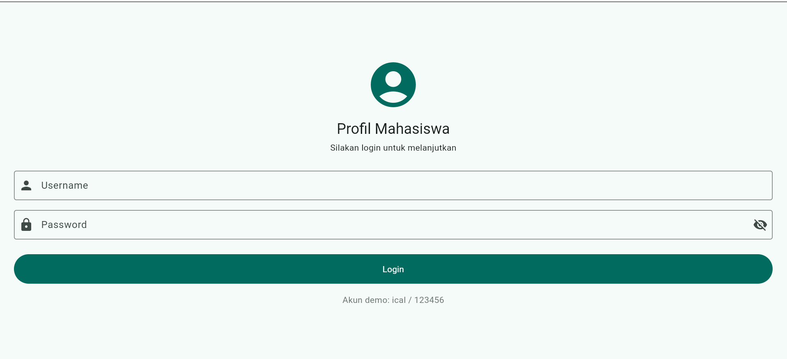
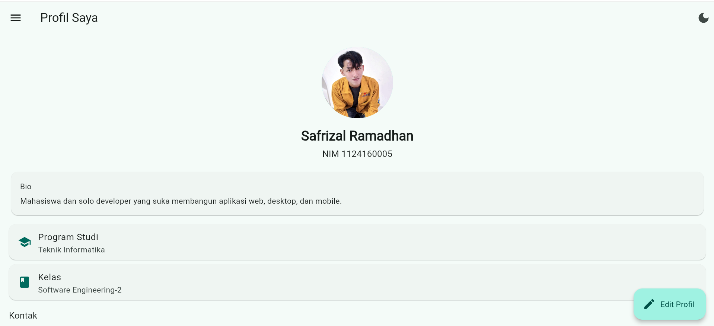
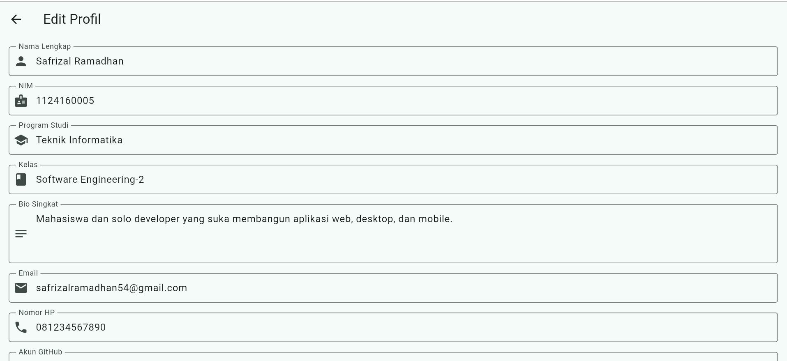

# Profil Mahasiswa (UTS PML - Soal 2)

## Identitas
- Nama : Safrizal Ramadhan
- NIM  : 1124160005
- Kampus : Institut Teknologi & Bisnis Bina Sarana Global
- Mata kuliah : Pemrograman Mobile Lanjut (PML)

## Video Presentasi
[GANTI DENGAN LINK YOUTUBE](https://www.youtube.com/@safrizalramadhan162/)

## Screenshot
| Login | Profil | Edit Profil |
|-------|--------|-------------|
|  |  |  |

## Fitur
- Halaman Login (StatefulWidget, Form + validator, loading, pushReplacement)
- Halaman Profil (CircleAvatar dari assets, data diri, kontak dengan Card + ListTile)
- Halaman Edit Profil (validasi nama, email, nomor HP 10-13 digit; data dikirim balik lewat Navigator.pop)
- Halaman Tentang Saya (keahlian, hobi, riwayat pendidikan dengan ListView)
- Scaffold lengkap: AppBar, Drawer, FloatingActionButton
- Tema terang dan gelap dengan switch mode gelap di dalam aplikasi
- Nama aplikasi Android: Profil Ical

Akun demo login: `ical` / `123456`

## Struktur
```
lib/
├── main.dart
├── models/profile.dart
├── screens/login_page.dart
├── screens/profile_page.dart
├── screens/edit_profile_page.dart
├── screens/about_page.dart
└── widgets/info_tile.dart
```

## Cara Menjalankan
```bash
flutter pub get
flutter run
```

Build APK: `flutter build apk --release`
(APK diunggah ke GitHub Releases dengan tag v1.0.0).

## Paket Tambahan
Tidak ada, hanya `flutter` dan `cupertino_icons`.